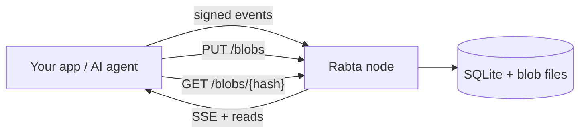

# Rabta

**Self-hosted backend for signed events, realtime streaming, and file uploads — in one Docker container.**

[](https://github.com/rabta-protocol/rabta/stargazers)
[](https://www.rust-lang.org/)
[](https://sqlite.org/)
[](https://github.com/rabta-protocol/rabta/pkgs/container/rabta)

Rabta is a self-hosted backend you run yourself. Your app publishes cryptographically signed events, Rabta stores them in SQLite, streams new ones live over Server-Sent Events (SSE), and stores files as content-addressed blobs. One Rust binary, one SQLite file, one container.

**No accounts. No database server. No app schema. No vendor lock-in.**

Rabta is deliberately dumb: it verifies a hash and an Ed25519 signature, stores opaque bytes, and never parses your data. Your client owns encryption, signing, and the data model. Rabta only stores and delivers.

> **Not a Nostr relay.** Rabta borrows the relay shape — signed events, pubkey identity, live tail — but uses plain HTTP + JSON + SSE, not Nostr wire format or NIPs. See [Rabta vs Nostr](#rabta-vs-nostr).

**Docs:** [api.md](api.md) — full API reference · OpenAPI at `GET /api/v1/openapi.json` · `GET /` returns a machine-readable route index.

## Quick Start

```bash
docker run -d \
  --name rabta \
  -p 3232:3232 \
  -v rabta:/data \
  --restart unless-stopped \
  -e STORAGE_LIMIT=20GB \
  ghcr.io/rabta-protocol/rabta:latest

curl -s http://localhost:3232/api/v1/health
# {"status":"ok","live_events":0,"live_blobs":0}
```

Your backend is live at `http://localhost:3232`. Images ship for **linux/amd64** and **linux/arm64** (`latest`, `X.Y.Z`, `dev`). Prefer Compose? [`compose.yml`](compose.yml) is a ready stack with a 20GB budget and a healthcheck.

```bash
# Publish a signed event (see api.md for signing code).
curl -X POST http://localhost:3232/api/v1/events \
  -H 'content-type: application/json' -d @event.json

# Upload raw bytes — returns the SHA-256.
curl -X PUT --data-binary @file.bin http://localhost:3232/api/v1/blobs

# Stream live events.
curl -N 'http://localhost:3232/api/v1/events/stream?collection=chat/room-42'
```

## What you can build

| You are building | Rabta gives you |
| --- | --- |
| **AI agents** | Shared memory, task queues, append-only logs |
| **Local-first apps** | Encrypted event streams, offline-ready uploads |
| **Chat & collaboration** | Rooms, presence, messages, live SSE updates |
| **Multiplayer games** | Ephemeral rooms, player state, self-cleaning assets |
| **IoT & telemetry** | Signed time-series events with automatic retention |
| **Webhooks & integrations** | Durable inbox/outbox without a broker |
| **File drop & media** | Raw uploads addressed by SHA-256 |

## Features

- **Signed events** — Ed25519 + SHA-256 over canonical JSON. Idempotent publish, cursor pagination, fetch by ID.
- **Realtime streaming** — SSE with `Last-Event-ID` resume, 15-second keepalive, 256-subscriber default cap.
- **File uploads in the box** — `PUT /api/v1/blobs` streams raw bytes to disk and returns the SHA-256. No IPFS, gateway, or multipart.
- **Retention built in** — Every event has a mandatory TTL. Unclaimed blobs expire in 48 hours; blob claims expire with their latest live event.
- **One storage budget** — `STORAGE_LIMIT` covers envelopes + claimed blobs. Over-budget writes evict events first, largest footprint first.
- **Pin what matters** — `WHITELIST_PUBKEYS` protects chosen keys from eviction (TTL still applies).
- **Zero ops** — Rust + SQLite + Axum. No Postgres, Redis, Kafka, or cloud account. Permissive CORS, no proprietary SDK.

## How it works



1. **Client signs.** Canonicalize JSON, hash with SHA-256, sign with Ed25519, optionally encrypt.
2. **Rabta verifies and stores.** Check signature + TTL, write the opaque envelope to SQLite.
3. **Deliver and expire.** New events stream over SSE. Reads never extend deadlines; a reaper cleans up expired events and blobs.

The server never sees your plaintext, never runs your schema, never needs your keys.

## Rabta vs Nostr

Rabta is a **simpler alternative to a Nostr relay for app builders**, not a drop-in replacement.

| | Nostr relay | Rabta |
| --- | --- | --- |
| **Transport** | WebSocket (`REQ`/`EVENT`), optional NIP-42 | HTTP + JSON, SSE for live updates, no auth |
| **Identity** | secp256k1, Schnorr | Ed25519, SHA-256 event ID |
| **Events** | Kinds, tags, replaceable, NIP-09 deletion | Opaque `data`, `collection` + up to 10 `labels`, TTL only |
| **Filtering** | ids, authors, kinds, `#tags` | collection, owner, labels, cursor |
| **Attachments** | URLs in content | Files on Rabta disk, addressed by SHA-256 |
| **Network** | Many-relay, outbox/gossip | Single node, scale the volume |

A Nostr client cannot point at Rabta directly — interop needs an adapter. Choose Nostr for permissionless many-relay networks and existing Nostr clients. Choose Rabta when you want one container and no NIPs.

## Configuration

Set env vars or `KEY=VALUE` lines in `/data/config.env`. Process environment wins.

| Variable | Default | Meaning |
| --- | --- | --- |
| `PORT` | `3232` | HTTP port |
| `DATA_DIR` | `/data` | SQLite + blob directory |
| `STORAGE_LIMIT` | `20GB` | Byte budget for envelopes + claimed blobs |
| `SSE_SUBSCRIBER_CAP` | `256` | Max concurrent SSE clients |
| `WHITELIST_PUBKEYS` | — | Up to 64 `ed25519:<hex>` keys pinned from eviction |
| `RUST_LOG` | `info` | Log filter |

Hard limits: envelopes ≤100KB, TTLs 60s–10 years, single blob ≤1% of the budget, unclaimed blobs 48h. Full table in [api.md](api.md#limits-and-runtime-configuration).

Rabta has no auth. Anyone who can reach the node can publish. For public deployments, put it behind TLS and an authenticated reverse proxy.

## API

| Action | Route |
| --- | --- |
| Publish | `POST /api/v1/events` |
| List | `GET /api/v1/events?collection=&label=&owner=&limit=&cursor=` |
| Fetch | `GET /api/v1/events/{id}` |
| Stream | `GET /api/v1/events/stream` (SSE) |
| Upload | `PUT /api/v1/blobs` |
| Download | `GET /api/v1/blobs/{hash}` |

Full wire format, envelope fields, signing rules, blob plane, and client examples: [**api.md**](api.md).

## FAQ

**Is Rabta a database?**
No. Rabta is an event relay. It stores opaque, signed envelopes in SQLite. Your app decides the schema inside `data`.

**Do I need Postgres, Redis, or IPFS?**
No. One container, one SQLite file, blobs on local disk. That's the whole stack.

**How does authentication work?**
It doesn't — by design. Identity is cryptographic (Ed25519). For access control, add an authenticated reverse proxy.

**Can I use Rabta with my Nostr client?**
No. Rabta does not implement Nostr wire format or any NIP. You would need an adapter that translates Nostr events into Rabta envelopes.

**What happens when storage fills up?**
Events are evicted first (largest footprint first), then claimed blobs. Pinned (`WHITELIST_PUBKEYS`) data is never evicted; writes get `507 at_watermark` instead. See `/api/v1/stats`.

## Privacy model

Rabta is zero-knowledge in practice: no accounts, no app logic, no plaintext. It does see metadata — pubkey, collection, labels, sizes, timing — so encrypt client-side when that matters.

## Project status

Rabta is under active development (`0.0.1-dev`). The API is deliberately small and relay-shaped, not Nostr-compatible. Issues and PRs are welcome.

If Rabta saves you from building a backend, a ⭐ helps other builders discover it.

---
*Self-hosted backend · Rust · SQLite · signed events · SSE realtime API · content-addressed file storage · Ed25519 · zero-knowledge · AI agent memory · Nostr alternative · Docker*
