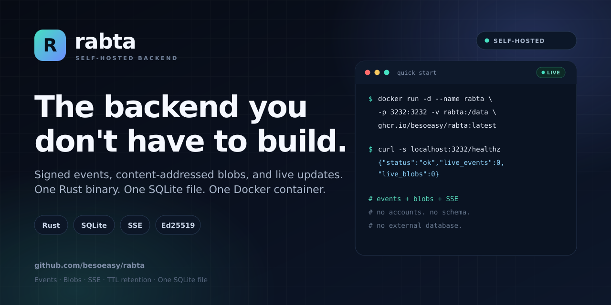
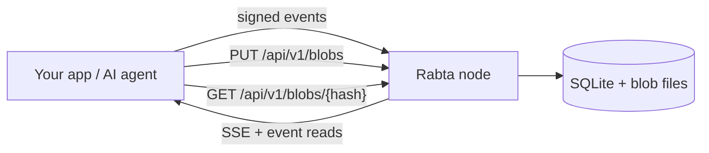

# Rabta

### The self-hosted, zero-knowledge dumb relay for signed events.

[](https://github.com/besoeasy/rabta/stargazers)
[](https://www.rust-lang.org/)
[](https://sqlite.org/)
[](https://github.com/besoeasy/rabta/pkgs/container/rabta)

<p align="center">
  
</p>

Rabta is the backend you run when you want to **ship the product, not the infrastructure**. It stores signed events in SQLite, streams changes over SSE, and expires data automatically — from one Rust binary, one SQLite file, and one Docker container.

Blobs are stored locally: raw bytes are content-addressed by SHA-256 and streamed to disk. An unclaimed blob lives 48 hours; a blob listed in a live event's `bin` expires with that event. Events and claimed blobs share one byte budget; unclaimed uploads stay outside it until an event claims them.

**No accounts. No app schema. No database server. No vendor lock-in.**

It is a deliberately dumb relay: it checks a hash and a signature, stores opaque bytes, and moves them around. There are no event kinds, replaceable-event rules, tag-query language, or NIPs to implement.

Clients encrypt and sign. Rabta verifies signatures, stores opaque envelopes, and never needs to understand your data.

**Not a Nostr relay.** Rabta borrows the relay shape — signed events, pubkey identity, an append-only log, a live tail — but it does not speak Nostr's wire protocol or implement NIPs. See [Rabta vs. Nostr relays](#rabta-vs-nostr-relays).

> **API reference:** [**api.md**](api.md) — every route, the cryptography, wire formats, and blob storage.
>
> **Jump to:** [publish an event](api.md#post-apiv1events) · [stream over SSE](api.md#get-apiv1eventsstream) · [upload a blob](api.md#put-apiv1blobs)

## Why Rabta?

- **Zero-knowledge by design** — payloads are encrypted and signed by clients; the node only sees ciphertext and metadata.
- **Dumb by design** — verify a hash and a signature, store opaque bytes, stream changes, expire data. No event kinds, merge rules, tag-query engine, or NIP surface.
- **One container, zero ops** — Rust + SQLite. No Postgres, Redis, Kafka, or cloud account required.
- **Blobs without another service** — `PUT /api/v1/blobs` streams raw bytes to local disk and returns the SHA-256. No IPFS daemon, pin ledger, or gateway to run.
- **Optional blob references** — an event may carry a `bin` array of 1–8 SHA-256 hashes, signed as part of its digest. Unclaimed blobs live 48 hours; named blobs expire with the latest live event that references them.
- **Realtime without extra services** — built-in Server-Sent Events with `Last-Event-ID` resume.
- **Retention that runs itself** — every event has a TTL; every blob has a derived deadline; both are reclaimed automatically.
- **One storage budget** — `STORAGE_LIMIT` counts event envelopes plus the blobs a live event claims. Unclaimed uploads are free for their 48-hour window. Over-budget writes evict events first, largest total footprint first (envelope plus blobs only that event claims), which may also release their blobs.
- **Pin the data that matters** — `WHITELIST_PUBKEYS` exempts chosen owners, and the blobs their live events claim, from storage-pressure eviction. TTL still applies to them.
- **Safe by default** — Ed25519 verification, size limits, storage watermarks, and eviction before the disk fills.
- **Browser-ready** — permissive CORS, plain HTTP, and no proprietary client SDK required.

## What you can build

| You're building | Rabta gives you |
| --- | --- |
| **AI agents** | Shared memory, task queues, and append-only event logs between agents |
| **Local-first / offline-first apps** | Durable event streams with encrypted payloads and content-addressed uploads |
| **Chat and collaboration** | Rooms, presence, messages, and live updates over SSE |
| **Relay-shaped apps** | Signed-event storage and live updates over plain HTTP — the relay model without NIPs or WebSocket subscriptions |
| **Multiplayer games** | Ephemeral rooms, player state, and assets that clean themselves up |
| **IoT and telemetry** | Signed time-series events with automatic retention |
| **Webhooks and integrations** | A durable event inbox/outbox without running a message broker |
| **File drop and media** | Raw uploads stored on the node, content-addressed by SHA-256 |

## Rabta vs. Nostr relays

Rabta is a **simpler alternative to a Nostr relay for app builders**, not a drop-in replacement for one. It keeps the useful shape of a relay and drops the protocol surface around it.

| | Nostr relay | Rabta |
| --- | --- | --- |
| **Transport** | WebSocket with NIP-01 `REQ` / `EVENT` / `EOSE` | Plain HTTP + JSON; SSE for live updates |
| **Identity** | secp256k1 Schnorr; id = SHA-256 of the Nostr event array | Ed25519; id = SHA-256 of the canonical Rabta object |
| **Event model** | Kinds, tags, replaceable and ephemeral events | Opaque `data`; `collection` + up to 10 `labels`; no kinds or replaceability |
| **Deletion** | NIP-09 deletion requests | TTL expiry and storage eviction only |
| **Filtering** | ids, authors, kinds, time, `#tags` | collection, owner, labels, opaque cursor |
| **Attachments** | URLs embedded in content | Files stored by Rabta on its own disk, addressed by SHA-256 |
| **Replication** | Open many-relay network, outbox/gossip, per-relay policy | Single node; no cluster mode. Scale the volume or run independent nodes |
| **Retention** | Relay-defined | Mandatory TTL for events, 48-hour unclaimed blobs, event-linked blob retention, storage watermark, automatic eviction |
| **Authentication** | Optional NIP-42 | None by design; use a reverse proxy |

**What that means in practice.** A Nostr client cannot point at Rabta and expect it to work. Rabta does not accept Nostr event JSON or implement NIP-01, NIP-09, NIP-40, NIP-42, or NIP-50. If you need Nostr interoperability, you need an adapter that translates events into Rabta envelopes. If you want relay-shaped primitives without the NIP surface, Rabta is the smaller system.

**Where Nostr is the better fit.** Open, permissionless, many-relay networks; clients that already speak Nostr; replaceable profiles and contact lists; relay discovery and outbox routing.

## Quick start

```bash
docker run -d \
  --name rabta \
  -p 3232:3232 \
  -v rabta:/data \
  --restart unless-stopped \
  -e STORAGE_LIMIT=20GB \
  ghcr.io/besoeasy/rabta:latest

curl -s http://localhost:3232/api/v1/health
# {"status":"ok","live_events":0,"live_blobs":0}
```

That's it. Your backend is live at `http://localhost:3232`. `STORAGE_LIMIT` is one budget for event envelopes plus blobs claimed by a live event; unclaimed uploads do not count until something references them. At boot the budget is clamped to 90% of the free space on the data volume. To pin owners against storage pressure, add `-e WHITELIST_PUBKEYS=ed25519:<64 hex>,<64 hex>`; see [Configuration and limits](#configuration-and-limits).

Prefer one file? [`compose.yml`](compose.yml) is a ready Portainer stack with a single Rabta service and its own volume. The stack fixes `STORAGE_LIMIT` at 20GB and passes `WHITELIST_PUBKEYS` through from the stack environment; change either in the compose file.

Images are published for **linux/amd64** and **linux/arm64**. Tags: `latest`, `YYYY.MM.DD` (the release date), and `dev`. Each release also attaches static musl binaries for both architectures with a `SHA256SUMS` file.

Rabta serves no HTML. A UI is a static app hosted anywhere that points at the node URL.

## How it works



1. **The client owns the data model.** It canonicalizes JSON, hashes it, signs with Ed25519, and optionally encrypts the payload.
2. **Rabta verifies and stores.** The node checks the signature and TTL, then writes an opaque envelope to SQLite.
3. **The event goes live.** Subscribers receive it over SSE. Blobs are a separate call: `PUT /api/v1/blobs` streams raw bytes to a temp file while hashing them, then moves the verified file into its content-addressed slot. `GET /api/v1/blobs/{hash}` streams it back with Range support.
4. **Retention runs itself.** Unclaimed blobs expire 48 hours after upload; blobs named in events expire with the latest live event that references them. Reads never extend a deadline. Expired events and blobs are reclaimed by the reaper.

The server never parses your application data, never runs your schema, and never needs a plaintext copy.

## Developer docs

Everything developers need lives in [**api.md**](api.md):

- [Event envelope, canonical JSON, and Ed25519 signing](api.md#cryptography-and-the-event-envelope)
- [Relay model, not Nostr](api.md#relay-model-not-nostr)
- [All public routes and exact response shapes](api.md#public-routes)
- [Blob upload, download, and retention](api.md#blob-plane)
- [Limits, environment variables, and copy-paste examples](api.md#limits-and-runtime-configuration)

The short version:

```bash
# Publish a signed envelope.
curl -X POST http://localhost:3232/api/v1/events \
  -H 'content-type: application/json' \
  --data-binary @event.json

# Upload raw bytes; the response carries the SHA-256 and deadline.
curl -X PUT --data-binary @file.bin http://localhost:3232/api/v1/blobs

# Fetch it back (Range and ETag supported).
curl -o file.bin http://localhost:3232/api/v1/blobs/<sha256>

# Stream live events.
curl -N 'http://localhost:3232/api/v1/events/stream?collection=chat/room-42'
```

The root route returns a machine-readable index of the public endpoints. A full OpenAPI 3.1 document is served at `GET /api/v1/openapi.json`.

## Configuration and limits

Set environment variables, or put `KEY=VALUE` lines in `/data/config.env`. Process environment wins. The knobs are `PORT`, `DATA_DIR`, `STORAGE_LIMIT`, `SSE_SUBSCRIBER_CAP`, `WHITELIST_PUBKEYS`, and `RUST_LOG`.

`WHITELIST_PUBKEYS` is a comma-separated list of up to 64 Ed25519 public keys, written bare (`<64 hex>`) or as `ed25519:<64 hex>`. Hex is case-insensitive, duplicates collapse, and empty entries are ignored. Events owned by those keys are never chosen for storage-pressure eviction, and neither is any blob a live whitelisted event claims. Their TTLs still apply, so they expire on schedule like everything else. Malformed keys, or more than 64 unique keys, refuse to boot.

`STORAGE_LIMIT` is one byte budget (default 20 GB) covering event envelopes plus every blob claimed by a live event. A 48-hour unclaimed upload is outside the budget until an event references it, and only the disk free floor applies. If `STORAGE_LIMIT` exceeds 90% of free disk at boot, it is clamped to 90%. `STORAGE_LIMIT=0` refuses to boot, and there is no way to disable blob routes. A single blob may be at most 1% of `STORAGE_LIMIT`. Event envelopes are capped at 100 KB, event TTLs range from 60 seconds to 10 years, unclaimed blobs live 48 hours, and claimed blobs expire with their latest live event.

If pinned data alone fills the budget, the node refuses new writes with `507 at_watermark` rather than deleting pinned rows; `/api/v1/stats` reports `whitelist_keys`, `whitelist_event_bytes`, and `whitelist_blob_bytes` so you can see it coming.

There is no IPFS, Kubo, CID, `STORAGE_MAX`, `.bin`, `.dir`, multipart upload, or blob listing route. Identity is always the lowercase hex SHA-256 of the raw body.

The full table is in [Limits and runtime configuration](api.md#limits-and-runtime-configuration).

## Privacy model

Rabta is zero-knowledge in the practical sense: it has no accounts, no application logic, and never needs plaintext. It does see metadata — public key, collection, labels, blob-reference hashes, sizes, and timing. Encrypt payloads client-side when that metadata matters.

Blob bytes live on the node's own disk. A blob's identity reveals its content hash, so encrypt before upload if that matters.

For a hardened deployment, put the node behind TLS and an authenticated reverse proxy if it is reachable from the internet.

## Project status

Rabta is under active development (`0.0.1-dev`). The core API is deliberately small. It is relay-shaped, not Nostr-compatible: no NIPs are implemented. Issues and pull requests are welcome.

If Rabta saves you from building a backend, a ⭐ helps other builders discover it.

## Keywords

Self-hosted backend · Rust backend · SQLite backend · event store · content-addressed storage · realtime API · Server-Sent Events · SSE · local-first apps · offline-first apps · Ed25519 · end-to-end encryption · zero-knowledge backend · privacy-first · AI agent memory · Nostr alternative · dumb relay · Docker · Axum · backend as a service
