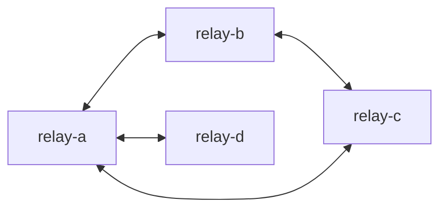

# Rabta

**The sync backend you can run in one container — and never babysit.**

Rabta is a self-hosted relay for signed events and files. Publish data, query it, and replicate it across nodes as a **peer mesh** — with no accounts, database server, schema migrations, or replication service to manage. It is an append-only, content-addressed log that keeps itself in sync.


**[Quick start](#quick-start)** · **[API reference](api.md)** · **[How sync works](#decentralized-sync)** · **[When to use it](#when-to-use-rabta)**

## Why developers pick Rabta

- **Ship the data layer in an afternoon** — `docker run` one image and you have a working HTTP API for publishing, querying, and file storage. No migrations, no ORM, no separate database to host.
- **Stay in control** — runs on your hardware or your VPS, stores everything in a volume you own, and never phones home. No vendor lock-in and no per-seat bill.
- **Decentralized by design** — point nodes at each other with one env var. They reconcile differences with adaptive range summaries and stream only what is missing.
- **Trust without trusting the server** — every event is Ed25519-signed and content-addressed, so clients and peers can verify who published what and that it was not altered.
- **Built for rough networks** — tolerant of low bandwidth, offline nodes, and flaky peers, with bounded transfers, retries, and exponential backoff.

## Quick start

Run one container with Docker or Podman:

**Docker**

```bash
docker run -d \
  --name rabta \
  -p 127.0.0.1:3232:3232 \
  -v rabta:/data \
  --restart unless-stopped \
  -e STORAGE_LIMIT=20GB \
  ghcr.io/rabta-protocol/rabta:latest
```

**Podman**

```bash
podman run -d \
  --name rabta \
  -p 127.0.0.1:3232:3232 \
  -v rabta:/data \
  --restart unless-stopped \
  -e STORAGE_LIMIT=20GB \
  ghcr.io/rabta-protocol/rabta:latest
```

Confirm it is running and inspect the node:

```bash
curl -fsS http://localhost:3232/api/v1/health
curl -fsS http://localhost:3232/api/v1/node
curl -fsS http://localhost:3232/api/v1/stats
```

The relay is available at `http://localhost:3232`. The `rabta` volume keeps your data when the container is replaced. To publish your first signed event, see [Publish an event](api.md#post-apiv1events).

These commands bind the relay to localhost only. To allow remote access, change the port mapping and use a reverse proxy with HTTPS and authentication. Rabta has no built-in account-based access control.

### Run the static binary

Prebuilt Linux binaries (musl) for `amd64` and `arm64` are attached to each [release](https://github.com/rabta-protocol/rabta/releases/latest). Use this when you do not want a container:

```bash
curl -fsSL https://github.com/rabta-protocol/rabta/releases/latest/download/rabta-linux-amd64 -o rabta
chmod +x rabta
DATA_DIR=./data PORT=3232 ./rabta
```

On `arm64`, fetch `rabta-linux-arm64` instead. Verify the download with the release's `SHA256SUMS`.

### Config vars

Pass variables with `-e NAME=value` in the run command. Relay settings can also go in `/data/config.env`; environment variables take priority. Set `DATA_DIR` and `RUST_LOG` through environment variables only.

| Variable | Default | What it controls |
| --- | --- | --- |
| `PORT` | `3232` | HTTP port inside the container. Update the port mapping if changed. |
| `DATA_DIR` | `/data` | Directory for the database, files, and optional `config.env`. |
| `STORAGE_LIMIT` | `20GB` | Hard cap on events and files, shown verbatim in the status panel; reduced at startup if free disk space is low. |
| `PROTECTION` | Empty | Single-line JSON `{"rules":[...]}` naming records exempt from storage-pressure eviction, e.g. `{"rules":[{"collection":["notes*"]},{"owner":["ed25519:<64 hex>"],"labels":["keep"]}]}`. Rule fields are `owner`, `collection`, `labels`; an omitted field or `*` matches anything, rules OR, fields AND. Max 16 rules, 32 values per field. Expiry still applies. Malformed JSON refuses to boot. |
| `SYNC` | Empty | Up to four comma-separated peer node URLs that form this node's mesh, such as `https://relay.example.com`. See [Decentralized sync](#decentralized-sync). |
| `REGEN` | `600` | Battery units regenerated per minute. The tank is hardcoded at `1000000` and is not configurable. |
| `BITCOIN_ADDRESS` | Empty | Optional on-chain Bitcoin donation address for the operator, shown publicly at `GET /api/v1/node` and on the status page. Accepts legacy (`1…`, `3…`), segwit (`bc1…`/`tb1…`), or a `bitcoin:` URI prefix; the checksum is verified at boot and an invalid value refuses to start. |
| `RUST_LOG` | `info` | Log level: `error`, `warn`, `info`, or `debug`. |

## What it does

- Verifies event signatures and stores events in SQLite.
- Lets clients query events by collection, labels, or owner.
- Stores files on disk and identifies them by their SHA-256 hash.
- Replicates events and their files between configured peers.
- Cleans up expired data and evicts unprotected data under storage pressure.

Events cannot be edited or deleted by clients. They expire after their specified lifetime (60 seconds to 300 days) or may be evicted to make room. Rabta does not query inside your event payloads, and files must arrive already encrypted: the relay stores only client-encrypted blobs and never holds a key.

## When to use Rabta

Rabta fits when your app needs a shared, append-only record that several nodes can serve and reconcile:

- **Local-first apps** that sync notes, messages, tasks, or device state.
- **Decentralized social** where clients own their keys and choose their relays.
- **Private file exchange** addressed by hash rather than filename.
- **Edge and IoT fleets** that come and go over slow or unreliable links.
- **Small-team backends** that need a shared source of truth without a platform.

It is a poor fit when you need:

- **In-place updates, joins, or queries inside payloads** — use a database.
- **Built-in accounts or access control** — put Rabta behind an authenticating proxy.
- **Server-side encryption** — there is none: files must be encrypted on the client before upload.
- **A permanent archive** — events expire and may be evicted.

## Features

- **One-container setup** — run a relay without managing a separate database or file-storage service.
- **Signed events** — verify which key published an event and detect changes to its contents.
- **Flexible payloads** — use your own data format without server-side schema migrations.
- **Client-side encryption required for files** — uploads are `RABTA1` encrypted containers under a key the relay never sees; metadata remains visible.
- **Content-addressed files** — retrieve files by hash and avoid storing duplicate content.
- **Decentralized peer mesh** — share events and files with other nodes peer-to-peer, with no central hub or leader.
- **Range-based reconciliation** — exchange compact range summaries and repair divergent windows in 1 round trip.
- **Streaming transfers** — move files without loading the entire file into server memory.
- **Storage controls** — limit stored data, with a separate staging allowance for files not yet referenced by an event (10% of the limit, at most 100 files).
- **Owner pinning** — protect selected owners' data from storage-pressure eviction, but not expiry.
- **Automatic expiry** — remove old data without writing a cleanup job.
- **Sync abuse controls** — limit sync work with a work battery and penalize misbehaving peers to reduce resource exhaustion.
- **Health and stats endpoints** — monitor availability, stored data, and battery state.

## Decentralized sync

Rabta nodes form a peer mesh, not a hub-and-spoke cluster. Set `SYNC` on each node to up to four peer base URLs and every node becomes both a producer and a consumer: it pushes what it has, pulls what it is missing, and repairs gaps on its own. There is no coordinator, leader election, or consensus round to operate.



```bash
# relay-a
-e SYNC=https://relay-b.example.com,https://relay-c.example.com

# relay-b
-e SYNC=https://relay-a.example.com
```

Peers need not be symmetric: a node can pull from a peer that never syncs back, and any node can join or leave at any time. When a node returns, it reconciles its range digests and restores whatever diverged while it was away.

### What happens in a sync pass

Each pass is a single signed `POST /api/v1/sync` that carries push, range reconciliation, and pull in one request-response cycle, so both directions converge in one round trip.

1. **Authenticate.** The caller signs the request body with its node Ed25519 key and sends `X-Rabta-Node`, `X-Rabta-Timestamp`, `X-Rabta-Nonce`, and `X-Rabta-Signature`. The receiver checks the signature, a 60-second clock window, and a nonce cache, so captured requests cannot be replayed.
2. **Push.** The caller sends newly published events or events the peer requested. The receiver re-verifies every envelope — canonical digest, `id`, signature, expiry — before storing it, so a peer cannot inject forged data. Duplicate IDs are dropped by a 64,000-entry in-memory filter before they reach SQLite.
3. **Reconcile & Repull.** Both sides exchange root and range summaries. The receiver immediately returns missing events in `pull_events` and identifies any events the caller needs to push. If an event was deleted on either node, it is automatically repulled to maintain exact mirror convergence.
4. **Move files.** Events that reference missing SHA-256 blobs enqueue them for download from the peer; blobs the peer is missing trigger an upload. Transfers stream from disk, verify the hash on arrival, and retry with exponential backoff.

### Range-based set reconciliation

Comparing two nodes naively means streaming the whole event set. Rabta instead uses **Adaptive Range-Based Set Reconciliation**: events are ordered chronologically by `(created_at, id)`, and each time range stores a count plus an 8-byte XOR fold of its hashes.

- **Ranges match** — the nodes hold the exact same set in that time window; 0 bytes are exchanged.
- **Ranges differ (small diff)** — the peer immediately serves the missing events in `pull_events` and reports `known_ids`. If an event was deleted or lost on either node, it is automatically repulled and restored in **1 round trip**.
- **Large divergence** — the peer adaptively bisects the divergent range in half so the nodes quickly pinpoint differences without bandwidth spikes.

Routine syncs cost only a few hundred bytes, and any missing or deleted event is self-healed into an exact copy without requiring full log streaming or cursors.

### Why it stays consistent

Event IDs are content hashes and events are immutable: no client can edit or delete one, and they leave a node only by expiry or storage-pressure eviction. Sync is a **set union**, not a merge — concurrent writes on different nodes cannot conflict, and there is no last-writer-wins rule to reason about. Nodes converge as each pass fills the gaps in its set.

### Abuse resistance

An open peer mesh needs a way to say "no" without an allowlist:

- **Work battery** — every node holds one battery (default `1000000`, regenerating `600`/minute via `REGEN`). Each write is charged by real work: 1 per event, 100 per new blob, and 10× the sender's penalty per pushed batch. Duplicates are free. Two floors: below 75% battery sync is disabled entirely — the node stops polling peers and refuses sync ingress with `429` (local writes keep working); below 100 it is read-only. A refused write returns `429` with a `Retry-After` instead of doing the work. See [Battery](api.md#battery).
- **Per-peer penalties** — a failed or malformed sync adds a strike; each strike doubles that peer's cost multiplier and polling interval (5 s base, up to 64× backoff). Clean passes pay a strike back down.
- **Bounded requests** — a sync request is capped at 2 MiB plus 64 KiB on the wire.
- **Verified ingest** — no event is trusted because it came from a peer; signatures and expiry are checked again on arrival.

For the wire format and request fields, see [`POST /api/v1/sync`](api.md#post-apiv1sync).

## Ecosystem & Community

Discover public relays and apps built by people on [**awesome-rabta**](https://github.com/rabta-protocol/awesome-rabta):

- **Public Nodes & Relays** — connect to community-hosted public relays, seed nodes, and testing clusters.
- **Apps Built by People** — explore applications, decentralized tools, and platforms built on top of Rabta.
- **Client SDKs & Tools** — developer libraries, cryptographic signing utilities, and starter templates.

Have you built an app or are you hosting a public relay? Submit a pull request to [**awesome-rabta**](https://github.com/rabta-protocol/awesome-rabta) to get listed!

## License

Licensed under either MIT or Apache-2.0, at your option.
