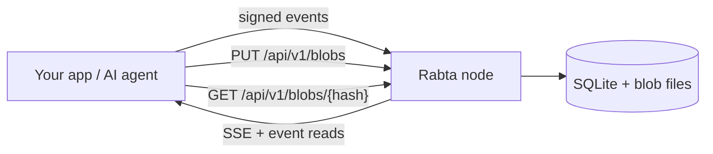

# Rabta

### The self-hosted, zero-knowledge dumb relay for signed events.

[](https://github.com/rabta-protocol/rabta/stargazers)
[](https://www.rust-lang.org/)
[](https://sqlite.org/)
[](https://github.com/rabta-protocol/rabta/pkgs/container/rabta)

Rabta is the backend you run when you want to **ship the product, not the infrastructure**: signed events in SQLite, live changes over SSE, and automatic expiry — from one Rust binary, one SQLite file, and one container. Blobs are content-addressed by SHA-256 on local disk: unclaimed ones live 48 hours, `bin`-referenced ones expire with their latest live event, and events plus claimed blobs share one byte budget while unclaimed uploads stay outside it.

**No accounts. No app schema. No database server. No vendor lock-in.**

It is a deliberately dumb relay: verify a hash and a signature, store opaque bytes, move them around. No event kinds, replaceable-event rules, tag-query language, or NIPs. Clients encrypt and sign; Rabta verifies and stores without ever understanding your data.

**Not a Nostr relay.** It borrows the relay shape — signed events, pubkey identity, an append-only log, a live tail — but not Nostr's wire protocol or NIPs. See [Rabta vs. Nostr relays](#rabta-vs-nostr-relays).

> **API reference:** [**api.md**](api.md) — every route, the cryptography, wire formats, and blob storage.
>
> **Jump to:** [publish an event](api.md#post-apiv1events) · [stream over SSE](api.md#get-apiv1eventsstream) · [upload a blob](api.md#put-apiv1blobs)

## Why Rabta?

- **Zero-knowledge, dumb by design** — clients sign and encrypt; the node verifies the hash and Ed25519 signature, stores opaque bytes, and never parses your data.
- **One container, zero ops** — Rust + SQLite; no Postgres, Redis, Kafka, or cloud account.
- **Blobs in the box** — `PUT /api/v1/blobs` streams raw bytes to disk and returns the SHA-256; an optional signed `bin` list (1–8 hashes) ties blobs to an event. No IPFS, pin ledger, or gateway.
- **Realtime and retention built in** — SSE with `Last-Event-ID` resume; mandatory TTLs and automatic reclamation of events and blobs.
- **One storage budget** — `STORAGE_LIMIT` covers envelopes plus blobs claimed by live events; over-budget writes evict events first, largest footprint first, which may release their blobs.
- **Pin what matters** — `WHITELIST_PUBKEYS` protects chosen owners and the blobs their live events claim from eviction; TTL still applies.
- **Safe and browser-ready** — size limits, storage watermarks, eviction before the disk fills, permissive CORS, and no proprietary SDK.

## What you can build

| You're building | Rabta gives you |
| --- | --- |
| **AI agents** | Shared memory, task queues, append-only logs |
| **Local-first apps** | Encrypted event streams and content-addressed uploads |
| **Chat and collaboration** | Rooms, presence, messages, live SSE updates |
| **Relay-shaped apps** | Signed-event storage without NIPs or WebSockets |
| **Multiplayer games** | Ephemeral rooms, player state, self-cleaning assets |
| **IoT and telemetry** | Signed time-series events with automatic retention |
| **Webhooks and integrations** | A durable inbox/outbox without a broker |
| **File drop and media** | Raw uploads addressed by SHA-256 |

## Rabta vs. Nostr relays

Rabta is a **simpler alternative to a Nostr relay for app builders**, not a drop-in replacement. It keeps the relay shape and drops the protocol surface.

| | Nostr relay | Rabta |
| --- | --- | --- |
| **Transport & auth** | WebSocket with NIP-01 `REQ` / `EVENT` / `EOSE`, optional NIP-42 | Plain HTTP + JSON, SSE for live updates; no auth by design, use a reverse proxy |
| **Identity** | secp256k1 Schnorr; id = SHA-256 of the event array | Ed25519; id = SHA-256 of the canonical Rabta object |
| **Events** | Kinds, tags, replaceable/ephemeral events, NIP-09 deletion | Opaque `data`; `collection` + up to 10 `labels`; no kinds or replaceability; TTL/eviction only |
| **Filtering** | ids, authors, kinds, time, `#tags` | collection, owner, labels, opaque cursor |
| **Attachments** | URLs embedded in content | Files on Rabta's disk, addressed by SHA-256 |
| **Replication** | Many-relay network, outbox/gossip | Single node; no cluster mode. Scale the volume or run independent nodes |
| **Retention** | Relay-defined | Mandatory TTL, 48-hour unclaimed blobs, event-linked blobs, watermark, eviction |

**In practice.** A Nostr client cannot point at Rabta: it accepts no Nostr event JSON and implements no NIPs (not NIP-01, 09, 40, 42, or 50). Interop needs an adapter that translates events into Rabta envelopes. Nostr fits better for open, permissionless many-relay networks, existing Nostr clients, replaceable profiles and contact lists, and relay discovery/outbox routing.

## Quick start

```bash
docker run -d \
  --name rabta \
  -p 3232:3232 \
  -v rabta:/data \
  --restart unless-stopped \
  -e STORAGE_LIMIT=20GB \
  ghcr.io/rabta-protocol/rabta:latest

curl -s http://localhost:3232/api/v1/health
# {"status":"ok","live_events":0,"live_blobs":0}
```

Your backend is live at `http://localhost:3232`. `STORAGE_LIMIT` is one budget for envelopes plus blobs claimed by live events (unclaimed uploads don't count until referenced), clamped at boot to 90% of free disk; add `-e WHITELIST_PUBKEYS=ed25519:<64 hex>,<64 hex>` to pin owners (see [Configuration and limits](#configuration-and-limits)).

Prefer one file? [`compose.yml`](compose.yml) is a ready Portainer stack with its own volume that fixes `STORAGE_LIMIT` at 20GB and passes `WHITELIST_PUBKEYS` through. Images ship for **linux/amd64** and **linux/arm64** (tags `latest`, `YYYY.MM.DD`, `dev`), with static musl binaries and `SHA256SUMS` per release. Rabta serves no HTML — host a static UI anywhere and point it at the node URL.

## How it works



1. **The client owns the data model.** It canonicalizes JSON, hashes it, signs with Ed25519, and optionally encrypts.
2. **Rabta verifies and stores.** It checks the signature and TTL, then writes an opaque envelope to SQLite.
3. **Live and blobs.** Subscribers get the event over SSE. `PUT /api/v1/blobs` streams and hashes bytes to a temp file before moving it into its content-addressed slot; `GET /api/v1/blobs/{hash}` streams it back with Range support.
4. **Retention runs itself.** Unclaimed blobs expire after 48 hours, named blobs with the latest live event referencing them; reads never extend a deadline, and the reaper reclaims expired data.

The server never parses your application data, runs your schema, or needs a plaintext copy.

## Developer docs

Everything else lives in [**api.md**](api.md): the event envelope, canonical JSON and Ed25519 signing, the relay model, all public routes and response shapes, the blob plane, and limits/runtime configuration.

```bash
# Publish a signed envelope.
curl -X POST http://localhost:3232/api/v1/events \
  -H 'content-type: application/json' \
  --data-binary @event.json

# Upload raw bytes; the response carries the SHA-256 and deadline.
curl -X PUT --data-binary @file.bin http://localhost:3232/api/v1/blobs

# Fetch it back (Range and ETag supported).
curl -o file.bin http://localhost:3232/api/v1/blobs/<sha256>

# Stream live events.
curl -N 'http://localhost:3232/api/v1/events/stream?collection=chat/room-42'
```

The root route returns a machine-readable index of public endpoints; the full OpenAPI 3.1 document is at `GET /api/v1/openapi.json`.

## Configuration and limits

Set environment variables or `KEY=VALUE` lines in `/data/config.env` (process environment wins): `PORT`, `DATA_DIR`, `STORAGE_LIMIT`, `SSE_SUBSCRIBER_CAP`, `WHITELIST_PUBKEYS`, `RUST_LOG`.

`WHITELIST_PUBKEYS` accepts up to 64 Ed25519 keys, bare (`<64 hex>`) or as `ed25519:<64 hex>`, case-insensitive; duplicates collapse and empty entries are ignored. Events owned by those keys, and any blob a live whitelisted event claims, are never evicted for storage pressure — TTLs still apply. Malformed keys or more than 64 unique keys refuse to boot.

`STORAGE_LIMIT` (default 20 GB) covers envelopes plus every blob claimed by a live event; a 48-hour unclaimed upload stays outside it until claimed and only faces the free-disk floor. It is clamped to 90% of free disk at boot, `0` refuses to boot, and blob routes can't be disabled. A single blob may be at most 1% of the budget; envelopes are capped at 100 KB, TTLs range from 60 seconds to 10 years, unclaimed blobs live 48 hours, and claimed blobs expire with their latest live event.

If pinned data alone fills the budget, new writes get `507 at_watermark` rather than deleting pinned rows; `/api/v1/stats` reports `whitelist_keys`, `whitelist_event_bytes`, and `whitelist_blob_bytes` so you can see it coming.

There is no IPFS, Kubo, CID, `STORAGE_MAX`, `.bin`, `.dir`, multipart upload, or blob listing. Identity is always the lowercase hex SHA-256 of the raw body. Full table: [Limits and runtime configuration](api.md#limits-and-runtime-configuration).

## Privacy model

Rabta is zero-knowledge in practice: no accounts, no application logic, no plaintext. It does see metadata — public key, collection, labels, blob-reference hashes, sizes, and timing — and blob identity reveals its content hash, so encrypt client-side when that matters. For a hardened deployment, put the node behind TLS and an authenticated reverse proxy.

## Project status

Rabta is under active development (`0.0.1-dev`). The API is deliberately small and relay-shaped, not Nostr-compatible. Issues and pull requests are welcome.

If Rabta saves you from building a backend, a ⭐ helps other builders discover it.

## Keywords

Self-hosted backend · Rust backend · SQLite backend · event store · content-addressed storage · realtime API · Server-Sent Events · SSE · local-first apps · offline-first apps · Ed25519 · end-to-end encryption · zero-knowledge backend · privacy-first · AI agent memory · Nostr alternative · dumb relay · Docker · Axum · backend as a service
